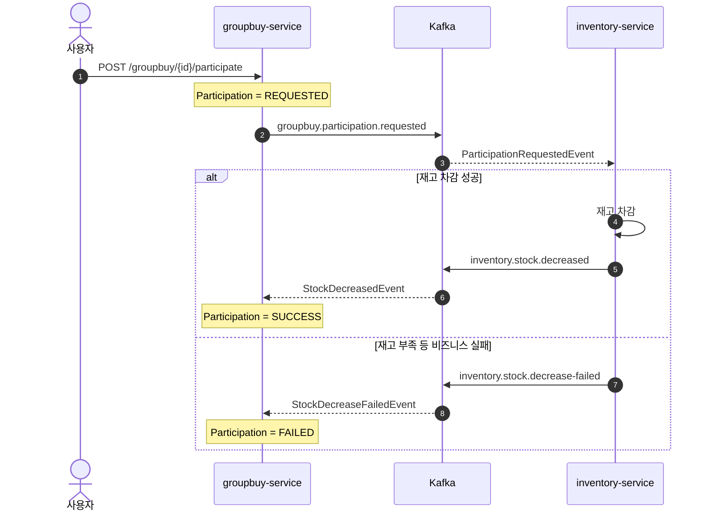

# 🛒 Event-Driven Group Purchase MSA

Apache Kafka와 Spring Boot 기반의 이벤트 주도 공동구매 시스템입니다.

공동구매 참여, 재고 차감, 주문 생성, 결제와 취소 보상을 비동기 이벤트로 연결합니다. 서비스별 데이터베이스를 분리하고 Choreography Saga 방식으로 서비스 간 결합도를 낮추면서 최종적 일관성을 관리하는 학습 프로젝트입니다.

## System Architecture

```text
                         HTTP API
                            |
                            v
                  +--------------------+
                  |  groupbuy-service  |
                  |  Java / Spring     |
                  +---------+----------+
                            |
                            | publish / consume
                            v
                  +--------------------+
                  |    Apache Kafka    |
                  |    KRaft mode      |
                  +---------+----------+
                            |
                            | publish / consume
                            v
                  +--------------------+
                  | inventory-service  |
                  | Kotlin / Spring    |
                  +--------------------+

          groupbuy-service             inventory-service
                  |                            |
                  v                            v
       PostgreSQL :5433             PostgreSQL :5434
```

### 공동구매 참여와 재고 차감



### 주문, 결제와 보상 흐름

1. 공동구매 목표 수량이 달성되면 `groupbuy.confirmed` 이벤트가 발행됩니다.
2. 참여 성공 건을 기준으로 주문을 생성하고 `order.created` 이벤트를 발행합니다.
3. 결제 결과는 `payment.completed` 이벤트로 주문 상태에 반영됩니다.
4. 주문 취소 시 `order.cancelled` 이벤트를 발행하고 inventory-service가 재고를 복구합니다.

목표 수량은 성사 기준입니다. 목표 달성 후 신규 참여 요청은 차단하지만, 달성 전에
접수된 참여는 재고 결과가 늦게 도착해도 확정합니다. 추가 확정 시 같은
`groupbuy.confirmed` 이벤트를 발행하고 아직 주문이 없는 성공 참여만 주문으로 만듭니다.
참여 확정은 참여 행 잠금, 주문 생성은 공동구매 행 잠금과 참여 ID 유일성 제약으로
중복 반영을 방지합니다. 기존 주문이 취소된 참여도 다시 주문하지 않습니다.

V6 마이그레이션은 기존 중복 주문이 있으면 중단하며 데이터를 자동 삭제하지 않습니다.
2026-11-11 별도 검증 DB에서 Flyway/JPA validate와 실제 Kafka/HTTP 흐름을 확인했습니다.
목표 1에 선접수한 2건 모두 주문·결제로 이어지고, 확정 이벤트 반복 전달에도 주문과
결제는 각 2건을 유지했습니다. 이 종단 검증은 재고 복구 멱등성 변경도 함께 적용한 상태에서 수행했습니다. 실제 병렬 실행을 통한 동시성 검증은 미실시입니다.

## Reliability

### Non-blocking Retry와 DLT

Kafka 리스너는 `@RetryableTopic`을 사용합니다. 시스템 예외가 발생하면 소비자 스레드에서 대기하지 않고 Retry 토픽으로 메시지를 이동시킨 후, 재시도를 모두 소모한 메시지를 DLT로 보냅니다.

```text
original topic
  → retry-1000
  → retry-2000
  → dlt
```

groupbuy-service와 inventory-service는 최종 실패 이벤트를 각 서비스의 `tb_failed_event`에 저장합니다.

| 컬럼 | 내용 |
| --- | --- |
| `topic` | 최초 원본 Kafka 토픽 |
| `original_partition` | 원본 Kafka 레코드의 파티션 (헤더 누락 시 NULL) |
| `original_offset` | 원본 Kafka 레코드의 오프셋 (헤더 누락 시 NULL) |
| `payload` | 재처리에 필요한 원본 이벤트 JSON |
| `error_message` | 마지막 처리 실패 메시지 |
| `created_at` | 실패 기록 시각 |

groupbuy-service와 inventory-service는 `(topic, original_partition, original_offset)` 복합 유일성 제약과 원자적인 중복 무시 INSERT를 사용합니다. 원본 좌표가 모두 있는 경우 동일한 원본 Kafka 레코드의 DLT 이벤트가 재전달되어도 한 번만 기록합니다.

원본 `partition` 또는 `offset` 헤더가 누락된 경우에도 실패 기록은 저장하며, 중복 방지를 보장할 수 없다는 WARN 로그를 남깁니다. 이 경우 재전달 시 중복 기록이 생길 수 있습니다. 기존 실패 기록의 원본 좌표는 NULL로 유지하며, 이번 변경으로 기존 중복 기록을 정리하지는 않습니다.

> Non-blocking Retry는 처리량을 보호하지만 동일 키 이벤트의 처리 순서가 달라질 수 있습니다. 도메인 상태 전이와 멱등성 보강은 지속적인 개선 대상입니다.

### 주문 취소 재고 복구 멱등성

inventory-service는 `stock_restore_history.order_id` PK와 충돌 무시 INSERT를 사용해
같은 주문의 재고 복구를 한 번만 반영합니다. 복구 기록과 재고 증가는 하나의 DB
트랜잭션에서 커밋하며, 재고 처리 실패 시 기록도 롤백합니다. 수량은 양수만 허용합니다.

같은 주문이 다른 eventId나 Kafka 좌표로 다시 전달되어도 재고를 추가로 늘리지 않습니다.
상품 또는 수량이 기존 복구 이력과 다르면 최초 결과를 유지하고, 저장된 값과 수신 값을
WARN 로그에 남깁니다. 실제 DB 오류는 기존 Retry/DLT 경로로 전달합니다.

주문당 전체 취소 한 번을 전제로 하며 부분 취소는 지원하지 않습니다. 도입 전에 이미
복구된 주문은 이력이 없으므로 과거 이벤트 재전달을 보호하지 못합니다. 복구 이력을
삭제하면 해당 주문의 중복 방지도 사라집니다. 실제 차감 여부 확인, 차감 멱등성과
DB 변경 후 Kafka 발행 실패는 별도 개선 대상입니다.

검증 현황(2026-11-11): JDK 21 빌드, 별도 DB의 Flyway/JPA validate,
실제 Kafka 순차 중복 및 내용 불일치, 결제 실패 복구, 없는 상품 처리 시 이력 롤백,
0/음수 수량 거부와 Retry/DLT, 상품 생성 후 동일 주문 재전달을 확인했습니다.
실제 병렬 실행을 통한 동시성 검증은 미실시입니다.

### Schema Management

- groupbuy-service와 inventory-service는 Flyway 마이그레이션과 `ddl-auto=validate`를 사용합니다.
- 서비스별 PostgreSQL 데이터베이스를 독립적으로 사용하며 다른 서비스의 테이블이나 Repository를 직접 참조하지 않습니다.
- Kafka payload는 Jackson 3 기반 message converter를 통해 이벤트 DTO로 바인딩됩니다.

## Tech Stack

| 분류 | 기술 |
| --- | --- |
| Runtime | Java 21 |
| Framework | Spring Boot 4.0.6 |
| Languages | Java, Kotlin 2.1 |
| Data | Spring Data JPA, PostgreSQL 16, Flyway |
| Messaging | Apache Kafka (KRaft), Spring Kafka |
| Serialization | Jackson 3 (`tools.jackson.*`) |
| Infrastructure | Docker, Docker Compose, Kafka UI |

## Services

### [groupbuy-service](services/groupbuy-service)

Java 기반 핵심 서비스입니다.

- 상품 등록과 조회
- 공동구매 생성·오픈과 상태·수량 조회
- 참여 요청 검증과 상태 관리 (잘못된 입력은 HTTP 400)
- 주문 생성, 결제 결과 반영과 취소
- Kafka Retry/DLT 및 최종 실패 이벤트 대사

주요 HTTP API:

| Method | Path | 설명 |
| --- | --- | --- |
| `POST` | `/products` | 상품 등록 |
| `GET` | `/products` | 상품 목록 조회 |
| `GET` | `/products/{productId}` | 상품 단건 조회 |
| `POST` | `/groupbuy` | 공동구매 생성 |
| `GET` | `/groupbuy/{groupbuyId}` | 공동구매 상태·목표 수량·현재 확정 수량 조회 |
| `POST` | `/groupbuy/{groupbuyId}/open` | 공동구매 오픈 |
| `POST` | `/groupbuy/{groupbuyId}/participate` | 공동구매 참여 요청 |

### [inventory-service](services/inventory-service)

Kotlin 기반 재고 서비스입니다.

- 상품 생성 이벤트를 통한 재고 등록
- 참여 요청 이벤트를 통한 재고 차감
- 재고 차감 성공·실패 이벤트 발행
- 주문 ID 기반 멱등성을 보장하는 주문 취소 재고 복구
- Kafka Retry/DLT 및 원본 레코드 좌표 기반 실패 이벤트 중복 방지

### Skeleton Services

- [product-service](services/product-service)
- [user-service](services/user-service)

향후 상품과 사용자 도메인을 별도 서비스로 분리하기 위한 애플리케이션 스켈레톤입니다.

## Run Locally

### Prerequisites

- JDK 21
- Docker 및 Docker Compose

### 1. Infrastructure

```bash
docker compose up -d
```

| Component | Address |
| --- | --- |
| Kafka external listener | `localhost:9094` |
| Kafka UI | [http://localhost:8989](http://localhost:8989) |
| groupbuy PostgreSQL | `localhost:5433` |
| inventory PostgreSQL | `localhost:5434` |

### 2. Applications

macOS/Linux:

```bash
cd services/groupbuy-service
./gradlew bootRun

cd ../inventory-service
./gradlew bootRun
```

Windows PowerShell:

```powershell
cd services/groupbuy-service
.\gradlew.bat bootRun

cd ..\inventory-service
.\gradlew.bat bootRun
```

| Service | Port |
| --- | --- |
| groupbuy-service | `8081` |
| inventory-service | `8082` |

## Main Kafka Topics

| Topic | Producer | Consumer | 목적 |
| --- | --- | --- | --- |
| `product.created` | groupbuy-service | inventory-service | 재고 초기화 |
| `groupbuy.participation.requested` | groupbuy-service | inventory-service | 재고 차감 요청 |
| `inventory.stock.decreased` | inventory-service | groupbuy-service | 참여 확정 |
| `inventory.stock.decrease-failed` | inventory-service | groupbuy-service | 참여 실패 |
| `groupbuy.confirmed` | groupbuy-service | groupbuy-service | 미주문 성공 참여의 주문 생성·추가 생성 |
| `order.created` | groupbuy-service | groupbuy-service | 결제 생성 |
| `payment.completed` | groupbuy-service | groupbuy-service | 주문 완료·취소 |
| `order.cancelled` | groupbuy-service | inventory-service, groupbuy-service | 재고 복구와 참여 실패 처리 |

## Roadmap

- Transactional Outbox를 통한 DB 트랜잭션과 Kafka 발행의 원자성 강화
- 이벤트 ID 기반 소비 멱등성 보장
- Retry/DLT lag 및 실패 이벤트 운영 모니터링
- 안전한 DLT Replay 절차와 복구 상태 관리
- malformed JSON처럼 DTO 변환 단계에서 실패한 메시지의 원문 보존
- API Gateway와 서비스 디스커버리 검토
